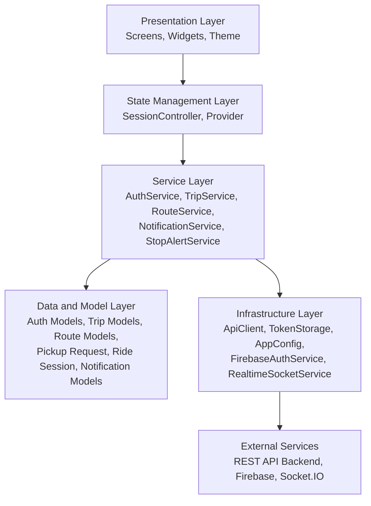
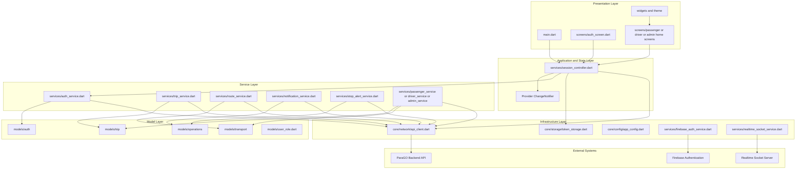

# ParaGO Client Layered Architecture Mermaid Code

## Figure. ParaGO Client Layered Architecture

## Alternative Version With Concrete Project Mapping

## Thesis Description

The ParaGO client applications use a layered architecture. The presentation layer contains the Flutter screens, widgets, and theme files responsible for the user interface. The state management layer is centered on `SessionController` with `Provider`, which manages authentication state, session restoration, and UI updates. The service layer contains application-specific services such as authentication, trip, route, notification, and stop alert services. These services use the data and model layer, which defines the client-side models for authentication, transport, trip, and operational records. Beneath them is the infrastructure layer, which handles API communication, token persistence, runtime configuration, Firebase integration, and realtime socket connectivity. This layered structure is shared across the passenger, driver, and admin clients, promoting separation of concerns, maintainability, and reuse.

## Notes

- This diagram represents the shared client architecture of `parago_passenger`, `parago_mobile`, and `parago_admin_web`.
- `SessionController` acts as the main application/state coordination layer in all three clients.
- `ApiClient` is the primary gateway to the backend API.
- `TokenStorage`, Firebase, and realtime services belong to the infrastructure layer rather than the UI layer.
