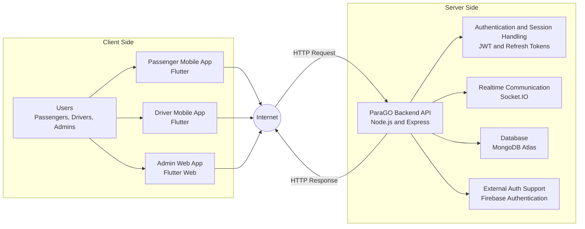
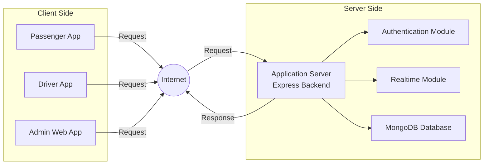

# ParaGO Client-Server Architecture Mermaid Code

## Figure. ParaGO Client-Server Architecture

## Alternative Thesis-Friendly Version

## Thesis Description

The ParaGO system follows a client-server architecture. On the client side, the system provides three user-facing applications: the passenger mobile application, the driver mobile application, and the admin web application. These clients communicate over the internet with the ParaGO backend server developed using Node.js and Express. The server is responsible for processing requests, managing authentication and sessions, handling realtime communication, and storing operational data in MongoDB. Firebase Authentication is also integrated to support selected authentication flows. This architecture enables centralized business logic, shared data access, and coordinated transport operations across all user roles.

## Notes

- Use the first figure if you want to explicitly show the actual technologies.
- Use the second figure if your adviser prefers a cleaner and more traditional thesis diagram.
- This is a client-server architecture figure, not a layered client architecture figure.
