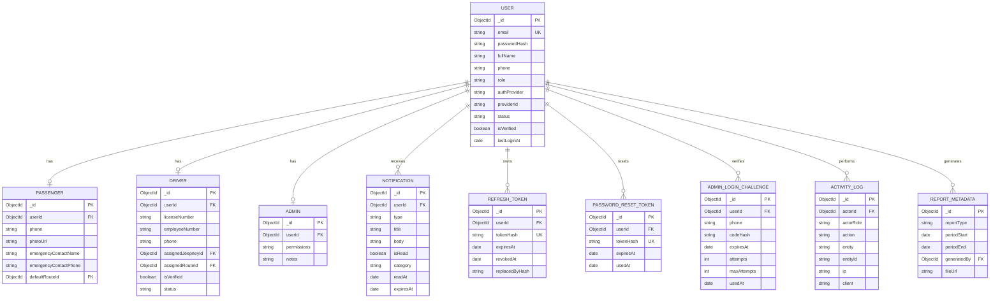
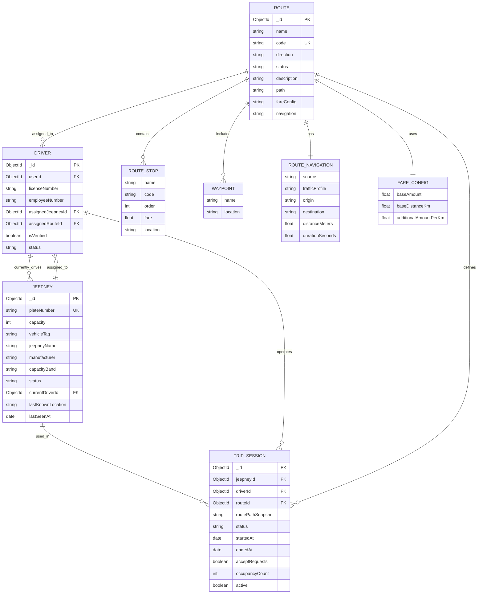
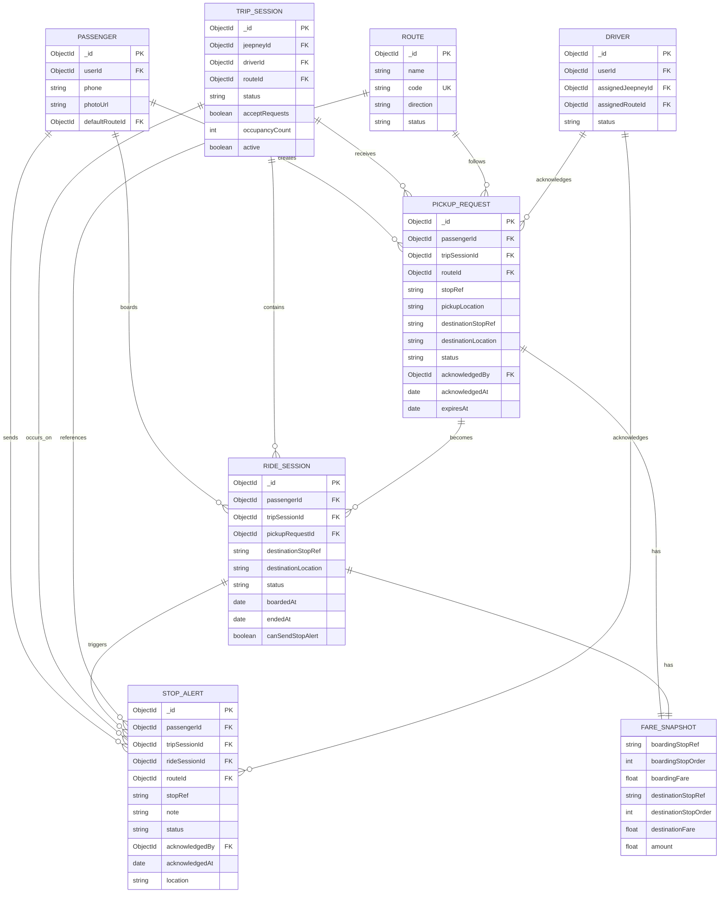

# ParaGO ERD Mermaid Code

## Figure 1. User and Access Management ERD

## Figure 2. Transport Operations ERD

## Figure 3. Passenger Ride Workflow ERD

## Notes

- `PK` means primary key.
- `FK` means foreign key style reference in MongoDB/Mongoose.
- `UK` means unique key.
- Embedded MongoDB objects were modeled as separate ERD items only where helpful for thesis readability.
