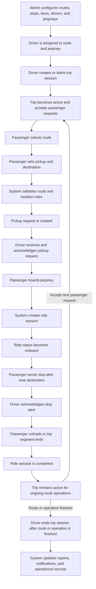

# ParaGO Main System Flow Mermaid Code

## Figure. ParaGO Main System Flow

## Alternative Version With Role Grouping

```mermaid
flowchart LR
    subgraph ADMIN[Admin Functions]
        A1[Create and manage routes]
        A2[Set stops and fare configuration]
        A3[Assign drivers and jeepneys]
    end

    subgraph DRIVER[Driver Functions]
        D1[Start trip session]
        D2[Receive pickup request]
        D3[Acknowledge request]
        D4[Continue trip]
        D5[Acknowledge stop alert]
        D6[End trip session]
    end

    subgraph PASSENGER[Passenger Functions]
        P1[Select route]
        P2[Choose pickup and destination]
        P3[Submit pickup request]
        P4[Board jeepney]
        P5[Send stop alert]
        P6[Complete ride]
    end

    subgraph SYSTEM[System Functions]
        S1[Validate route and location]
        S2[Create pickup request record]
        S3[Create ride session]
        S4[Update trip, notifications, and reports]
    end

    A1 --> A2 --> A3 --> D1
    D1 --> P1 --> P2 --> P3 --> S1 --> S2 --> D2 --> D3 --> P4 --> S3
    S3 --> D4 --> P5 --> D5 --> P6 --> D6 --> S4
```

## Notes

- This flow excludes login, registration, token refresh, OTP, and password recovery.
- It focuses only on the main operational functionality of the ParaGO system.
- Use the first diagram if you want a single end-to-end thesis figure.
- Use the second diagram if your adviser prefers grouped responsibilities by actor.
